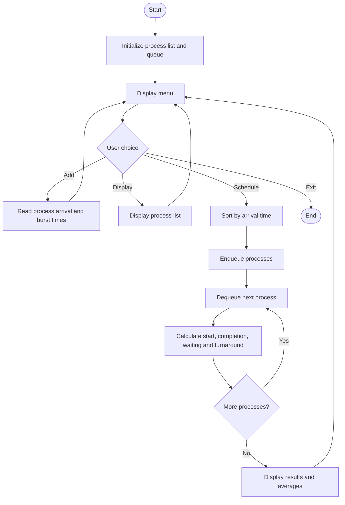

# CPU Process Scheduling Simulator – Queue

**Course:** CSS2281 – C Programming and Data Structures Lab  
**Language:** C  
**Data structure:** FIFO Queue  
**Scheduling algorithm:** First Come, First Served (FCFS)

## 1. Problem statement
Create a console-based application that demonstrates how an operating system can schedule processes using a ready queue. The program accepts process arrival and burst times, schedules processes in FCFS order, and calculates waiting time, turnaround time, and their averages.

## 2. Objectives
- Demonstrate queue operations: enqueue and dequeue.
- Simulate FCFS CPU scheduling.
- Calculate start time, completion time, waiting time, and turnaround time.
- Practice modular C programming, testing, and documentation.

## 3. Requirements
- A C compiler such as GCC (MinGW-w64 on Windows).
- Terminal or IDE such as VS Code.

## 4. Compile and run

### Windows PowerShell (GCC installed)
```powershell
gcc cpu_scheduling.c -o cpu_scheduling.exe
.\cpu_scheduling.exe
```

### Linux / macOS
```bash
gcc cpu_scheduling.c -o cpu_scheduling
./cpu_scheduling
```

## 5. How to use
1. Select **1 – Add processes**.
2. Enter the number of processes.
3. For each process, enter arrival time (0 or greater) and burst time (greater than 0).
4. Select **2 – Display processes** to view the input.
5. Select **3 – Run FCFS scheduling** to see execution order and timing results.
6. Select **4 – Exit**.

## 6. Formulas
- **Start time** = maximum of the previous completion time and the process arrival time.
- **Completion time** = start time + burst time.
- **Waiting time** = start time − arrival time.
- **Turnaround time** = completion time − arrival time.
- **Average waiting time** = sum of waiting times ÷ number of processes.
- **Average turnaround time** = sum of turnaround times ÷ number of processes.

## 7. Sample test data
Enter these three processes:

| Process | Arrival time | Burst time |
|---|---:|---:|
| P1 | 0 | 5 |
| P2 | 1 | 3 |
| P3 | 2 | 2 |

Expected FCFS order: **P1 → P2 → P3**

| Process | Start | Completion | Waiting | Turnaround |
|---|---:|---:|---:|---:|
| P1 | 0 | 5 | 0 | 5 |
| P2 | 5 | 8 | 4 | 7 |
| P3 | 8 | 10 | 6 | 8 |

Average waiting time = **3.33** time units.  
Average turnaround time = **6.67** time units.

## 8. Algorithm
1. Start the program and initialize an empty queue.
2. Read the number of processes and each process's arrival and burst times.
3. Sort processes by arrival time; retain input order for equal arrival times.
4. Enqueue processes in that order.
5. Dequeue each process in turn.
6. If the CPU is idle, advance the clock to the process's arrival time.
7. Calculate start, completion, waiting, and turnaround times.
8. Display each process's results and the average waiting and turnaround times.
9. End.

## 9. Flowchart (Mermaid)


## 10. Test cases
- **Normal case:** Three or more processes with different arrival times.
- **Same arrival time:** Verify input order is retained for equal arrival times.
- **CPU idle time:** First process arrives after time 0; CPU clock should advance to its arrival.
- **Invalid values:** Negative arrival time or zero/negative burst time should be rejected.
- **Empty list:** Scheduling without adding processes should display a helpful message.

## 11. Limitations and future enhancements
- FCFS is non-preemptive and may cause long waiting times for short processes behind long ones.
- This educational simulator uses a fixed capacity of 100 processes.
- Possible extensions: Shortest Job First (SJF), Priority Scheduling, Round Robin, a Gantt chart, and file-based result storage.

## 12. Team contribution plan (five members)
1. **Member 1 – Coordinator:** requirements, problem statement, integration.
2. **Member 2 – Queue implementation:** enqueue, dequeue, queue validation.
3. **Member 3 – Scheduling logic:** FCFS order and timing calculations.
4. **Member 4 – Testing:** test cases, output verification, bug fixing.
5. **Member 5 – Documentation and GitHub:** README, flowchart, screenshots, repository organization.

All members should understand the complete program and participate in the final demonstration. Update this plan with the actual work completed by each member.

## 13. Suggested GitHub repository structure
```text
CPU-Process-Scheduling-Simulator/
├── cpu_scheduling.c
├── README.md
└── screenshots/
    └── (add your own execution screenshots)
```

## 14. Conclusion
The project demonstrates how a FIFO queue can represent the ready queue in a simplified CPU scheduling system. By implementing FCFS in C, students can observe process order and understand waiting time and turnaround time calculations.
